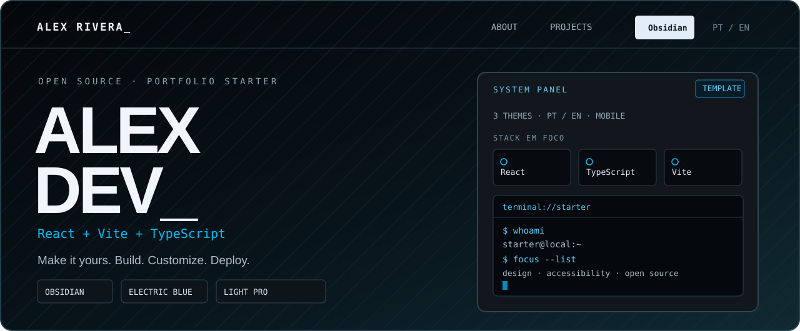

# Portfolio Starter

**Your portfolio. Your story. Your design.**

Template open source para criar seu próprio portfólio com visual inspirado em sistemas, três temas e conteúdo editável.

Open-source developer portfolio starter with a systems-inspired aesthetic, three themes and editable content.

[🇧🇷 Português](#portugues) · [🇬🇧 English](#english) · [Live visual inspiration](https://portfolio-dhm.pages.dev) · [MIT License](./LICENSE)

   

---

## 🇧🇷 Português

### O que é?

Um portfólio estático construído com **React, Vite, TypeScript, Tailwind CSS e Motion**. Pensado para quem quer apresentar seus projetos e sua trajetória com uma identidade visual moderna, sem precisar desenvolver tudo do zero.

O código acompanha dados **100% fictícios de Alex Rivera**. Nenhuma informação pessoal ou infraestrutura privada do autor faz parte do template.

**O que você encontra:**

- **3 temas:** Obsidian, Electric Blue e Light Pro, com preferência salva no navegador.
- **Responsivo:** layout pensado para desktop e celular, com atenção a toque, animações e acessibilidade.
- **PT-BR / EN:** alternância de idioma no site.
- **Conteúdo em JSON:** perfil, experiências, projetos, habilidades, objetivos e links.
- **Currículos em PDF:** quatro variantes geradas no build — português/inglês × infraestrutura/software.
- **Site estático:** hospede em Cloudflare Pages ou qualquer plataforma que sirva a pasta <code>dist/</code>.

### Rodar no seu computador

Requisitos: **Node.js 22+** e npm.

~~~bash
git clone https://github.com/Paulon34/portfolio-starter.git
cd portfolio-starter
npm ci
npm run dev
~~~

Abra o endereço local exibido pelo Vite.

### Personalizar em 5 passos

1. **Identidade:** edite <code>src/data/content/profile.json</code> (nome, apresentação, habilidades de interesse, e-mail público e links sociais).
2. **Foto:** substitua <code>public/images/profile.webp</code> por sua imagem.
3. **Projetos e carreira:** edite <code>src/data/content/projects.json</code> e <code>experience.json</code>. Um botão de repositório exige <code>href</code> válido e <code>repoPublic: true</code>.
4. **Currículos:** ao mudar <code>fullName</code>, atualize o caminho <code>resumePathTemplate</code> em <code>src/data/content/presentation.json</code>. O gerador usa o nome convertido em slug: <code>Maria Silva</code> → <code>/resume/maria-silva-{locale}-{focus}.pdf</code>.
5. **Acabamento:** ajuste <code>index.html</code> (título/descrição) e, se quiser, o texto <code>DEV_</code> em <code>src/sections/Hero.tsx</code>.

### Comandos de qualidade e build

~~~bash
npm run data:validate
npm run typecheck
npm run lint
npm run build
~~~

O <code>npm run build</code> valida o conteúdo, gera os quatro PDFs públicos em <code>public/resume/</code> e cria o site em <code>dist/</code>. Também é possível executar <code>npm run cv:generate</code> separadamente.

**Atenção:** os PDFs de demonstração são fictícios. Revise os dados e gere novamente os PDFs antes de publicar.

### Publicação opcional

Para **Cloudflare Pages com GitHub**:

| Campo | Valor |
| --- | --- |
| Framework | React (Vite) |
| Build command | <code>npm run build</code> |
| Output directory | <code>dist</code> |
| Production branch | Branch principal do seu repositório |

Não é necessário hospedar o template para clonar, estudar ou personalizar seu código.

### Privacidade e licença

Este projeto inclui **somente o frontend estático**. **Não** inclui Portfolio Admin privado, painel de login, Docker/CasaOS, Tailscale, tokens, senhas ou infraestrutura do autor. Não publique arquivos <code>.env</code>, chaves, telefone privado, PDFs particulares ou dados que não queira tornar públicos.

Licença **[MIT](./LICENSE)**. Você pode usar, adaptar e distribuir, inclusive comercialmente, mantendo o aviso de copyright e a licença. Sugestões e pull requests são bem-vindos!

---

## 🇬🇧 English

### What is it?

A static portfolio built with **React, Vite, TypeScript, Tailwind CSS and Motion**. It helps developers, IT infrastructure professionals and students showcase their projects and experience without starting from scratch.

All included content belongs to a **fictional demo persona, Alex Rivera**. No private author data or infrastructure configuration is shipped.

**Features:**

- **3 themes:** Obsidian, Electric Blue and Light Pro, with saved browser preference.
- **Responsive UI:** mobile-friendly layout, touch interactions and accessible motion.
- **PT-BR / EN:** bilingual portfolio interface.
- **Editable JSON:** profile, experience, projects, skills, goals and social links.
- **Résumé PDFs:** four build-generated variants — Portuguese/English × infrastructure/software.
- **Static hosting:** deploy <code>dist/</code> to Cloudflare Pages or any static host.

### Run locally

Requires **Node.js 22+** and npm.

~~~bash
git clone https://github.com/Paulon34/portfolio-starter.git
cd portfolio-starter
npm ci
npm run dev
~~~

Open the local URL displayed by Vite.

### Customize in 5 steps

1. **Identity:** edit <code>src/data/content/profile.json</code> for your name, bio, public email and social links.
2. **Photo:** replace <code>public/images/profile.webp</code>.
3. **Projects and experience:** edit <code>src/data/content/projects.json</code> and <code>experience.json</code>. Public project links require a valid <code>href</code> and <code>repoPublic: true</code>.
4. **Résumés:** when changing <code>fullName</code>, update <code>resumePathTemplate</code> in <code>src/data/content/presentation.json</code> to the matching slug: <code>Maria Silva</code> → <code>/resume/maria-silva-{locale}-{focus}.pdf</code>.
5. **Finishing touches:** update the title/description in <code>index.html</code> and optionally change the <code>DEV_</code> branding in <code>src/sections/Hero.tsx</code>.

### Quality checks and build

~~~bash
npm run data:validate
npm run typecheck
npm run lint
npm run build
~~~

<code>npm run build</code> validates the data, generates four public résumé PDFs in <code>public/resume/</code>, and writes the static site to <code>dist/</code>. Use <code>npm run cv:generate</code> to regenerate PDFs separately.

**Note:** shipped PDFs contain fictional demo information. Replace and regenerate them before deployment.

### Optional deployment

For **Cloudflare Pages connected to GitHub**:

| Setting | Value |
| --- | --- |
| Framework | React (Vite) |
| Build command | <code>npm run build</code> |
| Output directory | <code>dist</code> |
| Production branch | Your repository's default branch |

Hosting is optional if you just want to study or customize the code.

### Privacy and license

This repo contains **only the static frontend**. It does **not** provide the author's private Portfolio Admin, a login backend, CasaOS/Docker or Tailscale configuration, credentials, or personal secrets. Do not commit <code>.env</code> files, keys, private phone numbers or private résumé PDFs.

Licensed under **[MIT](./LICENSE)**. You may use, modify and redistribute it (including commercially) while preserving the license and copyright notice. Issues and contributions are welcome.

---

Built with curiosity, open source and a little terminal aesthetic.

**[Explore the live inspiration](https://portfolio-dhm.pages.dev)** · **[Back to top](#portfolio-starter)**

